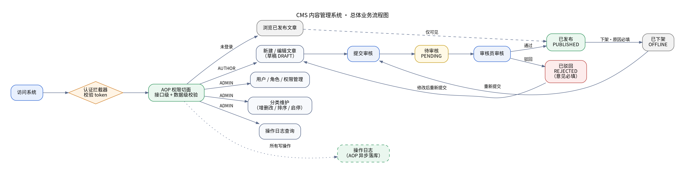
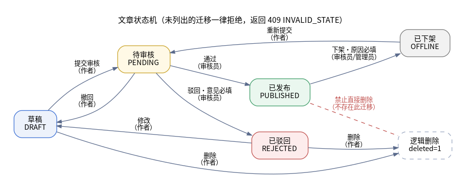

# 企业级 CMS 内容管理系统 · 需求分析说明书

| 项目 | 内容 |
|---|---|
| 课程 | 《JAVA 框架技术（一）》课程项目设计 |
| 项目名 | CMS 内容管理系统（基于实验二 SSM 整合升级） |
| 版本 | v1.0（D1 定稿，后续按实现回填） |
| 编写日期 | 2026-10-19 |
| 考核对应 | 评分表「一、项目架构与数据库设计 / 需求分析文档」1 分 |

---

## 1 项目概述

### 1.1 背景

本项目由实验二的 SSM 整合成果升级而来。实验二完成了 Spring + Spring MVC + MyBatis 的基础整合，但业务停留在单表 CRUD 层面，缺少权限、审核、日志等企业级系统固有的横切能力。本项目在此之上构建一个**可运行的 CMS 内容管理系统**，重点补齐三件事：

1. **多角色协作**：内容的生产、审核、发布由不同角色分担，而不是一个人想发就发；
2. **细粒度权限**：权限控制在接口层完成，由 Spring AOP 统一拦截，而不是散落在各 Service 的 if 判断里；
3. **可追溯**：每一次写操作都有日志，每一条内容都处于明确的状态机节点上。

### 1.2 目标

| 目标 | 衡量方式 |
|---|---|
| 内容生产→审核→发布全链路可跑通 | 4 个角色各登录一次，能完成一次完整的投稿-审核-发布 |
| 权限拦截真实生效 | 同一接口，无权限账号返回 403，有权限账号返回 200 |
| 数据不丢、不错 | 文章状态非法流转被拒绝，且返回明确原因 |
| 关键操作可追溯 | 每个写接口在 `sys_log` 中留有记录，可按操作人 / 时间查询 |

### 1.3 术语表

| 术语 | 含义 |
|---|---|
| 权限点 | 一个可被授权的最小操作单元，如 `article:delete` |
| 逻辑删除 | 数据行不物理删除，仅置 `deleted=1`，查询默认过滤 |
| 状态机 | 文章状态只允许沿规定的边迁移，非法迁移一律拒绝 |
| 横向越权 | 用户 A 操作了本属于用户 B 的数据 |
| 纵向越权 | 低权限角色调用了高权限接口 |

---

## 2 范围界定

### 2.1 本项目包含

- 后端服务：Spring Boot + Spring MVC + MyBatis-Plus，标准分层工程；
- 数据库：用户、角色、权限、文章、分类、日志六张主表 + 两张关联表；
- 四个角色的全部接口，覆盖评分表「基础核心功能」四项；
- 接口级权限校验（自定义注解 + AOP 切面）；
- 操作日志与登录日志；
- RESTful 接口规范、统一返回结构、统一异常处理；
- ApiFox 接口集合与联调用例；
- 一整套管理页与前台页（Thymeleaf 渲染 + 原生 ES Modules），用于真实演示业务链路；
- **站内引导智能体**：启动时反射生成站点地图，以卡片形式呈现全站页面，支持规则路由问答、权限感知与跳转高亮。

### 2.2 本项目**不包含**（明确划界，避免范围蔓延）

| 不做的事 | 原因 |
|---|---|
| 独立的前端框架工程（Vue/React） | 考核点为后端框架能力，前端仅作演示；接口以 ApiFox 为准 |
| 富文本编辑器集成、附件 / 图片上传与对象存储 | 与 SSM 框架能力无关，且引入额外依赖 |
| 全文检索引擎（Elasticsearch） | 数据库 `LIKE` + 索引已满足课程规模的数据检索要求 |
| 消息队列、分布式缓存、微服务拆分 | 单机单体架构足以承载本课程的数据量 |
| 第三方登录（微信 / 钉钉） | 无外部账号体系 |
| 多租户、国际化 | 超出课程范围 |
| 登录失败锁定 / 图形验证码 | 需要额外的计数存储与前端，课程场景价值低于成本；账号枚举已由"统一错误码"防住 |
| 智能体多轮上下文（指代消解、任务式对话） | L0 是关键词匹配，硬拼上下文只会让匹配变模糊；可靠的对话状态需要额外的会话存储，当前每次提问独立处理 |

---

## 3 角色与权限模型

### 3.1 角色定义

| 角色 | 编码 | 职责 | 典型用户 |
|---|---|---|---|
| 游客 | `GUEST` | 未登录，仅能浏览已发布文章 | 普通读者 |
| 作者 | `AUTHOR` | 撰写、修改自己的文章，提交审核 | 编辑、记者 |
| 审核员 | `AUDITOR` | 审核文章，通过 / 驳回，上下架 | 内容主管 |
| 管理员 | `ADMIN` | 用户、角色、权限、分类、日志全面管理 | 系统管理员 |

> 一个用户可拥有多个角色（用户-角色多对多），权限取并集。

### 3.2 权限点清单

| 权限点 | 说明 |
|---|---|
| `article:read` | 查看已发布文章 |
| `article:create` | 新建文章 |
| `article:update:own` | 修改本人文章 |
| `article:update:any` | 修改任意文章 |
| `article:delete:own` | 删除本人文章（仅草稿 / 驳回状态） |
| `article:submit` | 提交审核 |
| `article:audit` | 审核（通过 / 驳回） |
| `article:publish` | 上架 / 下架 |
| `category:read` | 查看分类 |
| `category:write` | 维护分类 |
| `user:manage` | 用户增删改查、角色分配 |
| `role:manage` | 角色与权限点分配 |
| `log:read` | 查看操作日志 |

### 3.3 权限矩阵

| 权限点 | 游客 | 作者 | 审核员 | 管理员 |
|---|:--:|:--:|:--:|:--:|
| `article:read` | ✓ | ✓ | ✓ | ✓ |
| `article:create` | ✗ | ✓ | ✗ | ✓ |
| `article:update:own` | ✗ | ✓ | ✗ | ✓ |
| `article:update:any` | ✗ | ✗ | ✗ | ✓ |
| `article:delete:own` | ✗ | ✓ | ✗ | ✓ |
| `article:submit` | ✗ | ✓ | ✗ | ✓ |
| `article:audit` | ✗ | ✗ | ✓ | ✓ |
| `article:publish` | ✗ | ✗ | ✓ | ✓ |
| `category:read` | ✓ | ✓ | ✓ | ✓ |
| `category:write` | ✗ | ✗ | ✗ | ✓ |
| `user:manage` | ✗ | ✗ | ✗ | ✓ |
| `role:manage` | ✗ | ✗ | ✗ | ✓ |
| `log:read` | ✗ | ✗ | ✗ | ✓ |

---

## 4 功能需求

> 每个场景按「参与者 / 触发条件 / 前置条件 / 主流程 / 异常分支 / 后置条件 / 验收标准」七项描述。
> 需求编号规则：`FR-模块-序号`，后续设计、编码、测试均引用该编号。

### 4.1 场景一：用户管理

**参与者**：管理员（管理他人）、普通用户（管理自己）
**触发条件**：管理员需要新增 / 停用账号；用户需要注册或登录
**前置条件**：系统已初始化管理员账号

**主流程**

| 步骤 | 操作 | 系统行为 |
|---|---|---|
| 1 | 用户提交注册（用户名、密码、昵称） | 校验唯一性与格式，密码 BCrypt 加密后入库，默认赋予 `AUTHOR` 角色 |
| 2 | 用户提交登录（用户名、密码） | 校验密码，把用户身份写入 Session（默认 30 分钟不活动过期），返回角色与权限点列表 |
| 3 | 用户携带 Session Cookie 访问接口 | 认证拦截器每个请求重新装载用户，把身份写入 `UserContext`；页面请求未登录则跳 `/login?next=…`，接口请求返回 401 |
| 4 | 管理员新增用户 / 修改用户 / 停用用户 | 校验操作权限，写操作日志 |
| 5 | 管理员为用户分配角色 | 更新用户-角色关联，用户下次请求即生效 |
| 6 | 用户点击退出 | 销毁 Session，该会话立即失效 |

**异常分支**

| 编号 | 分支条件 | 系统响应 | 处理规则 |
|---|---|---|---|
| E-USER-01 | 用户名已存在 | 400 `USERNAME_EXISTS` | 注册前置校验，唯一索引兜底 |
| E-USER-02 | 密码长度 < 6 或含非法字符 | 400 `PARAM_INVALID` | 参数校验统一拦截 |
| E-USER-03 | 用户名或密码错误 | 401 `LOGIN_FAILED` | 错误提示不区分「用户名不存在」和「密码错误」，防账号枚举 |
| E-USER-04 | 账号被停用 | 403 `ACCOUNT_DISABLED` | 停用即拒绝登录，但保留历史数据 |
| E-USER-05 | 未登录或 Session 已失效 | 401 `UNAUTHORIZED`（页面请求跳登录页） | 拦截器统一处理，不进入业务层；被停用/删除的账号即使持有旧 Session 也立即失效 |
| E-USER-06 | 管理员删除仍有关联文章的用户 | 409 `IN_USE`「该用户名下还有 N 篇稿件」 | 用户是逻辑删除，外键拦不住；删除前显式计数，避免文章指向已删除的作者 |

**后置条件**：用户表、用户-角色表更新；登录 / 登出写日志
**验收标准**：注册→登录→访问受保护接口→退出→token 失效，全链路通过

---

### 4.2 场景二：权限管控

**参与者**：所有角色；权限规则由管理员维护
**触发条件**：任意接口被调用
**前置条件**：接口已标注权限点注解

**主流程**

| 步骤 | 操作 | 系统行为 |
|---|---|---|
| 1 | 请求进入 | 认证拦截器校验 token，未登录直接 401 |
| 2 | 进入 Controller | AOP 切面读取方法上的 `@RequirePermission("article:audit")` |
| 3 | 切面取当前用户权限集合 | 未命中权限点则抛出 `ForbiddenException`，返回 403 |
| 4 | 数据级校验 | 涉及「本人数据」的接口（如 `article:update:own`）在 Service 层校验 `owner_id` |
| 5 | 管理员维护角色-权限 | 更新关联表，实时生效，无需重启 |

**异常分支**

| 编号 | 分支条件 | 系统响应 | 处理规则 |
|---|---|---|---|
| E-AUTH-01 | 未登录访问受保护接口 | 401 | 白名单（登录、注册、公开文章列表）放行 |
| E-AUTH-02 | 已登录但无该权限点 | 403 `FORBIDDEN` | 记录到操作日志，便于审计异常尝试 |
| E-AUTH-03 | 注解拼写错误 / 权限点不存在 | 500 + 启动期告警 | 启动时扫描全部 `@RequirePermission` 值，与权限表比对，发现未注册的权限点立即报错 |
| E-AUTH-04 | 横向越权（A 改 B 的文章） | 403 `NOT_OWNER` | 以数据库中的 `owner_id` 为准，不信任请求参数 |
| E-AUTH-05 | 权限缓存与库不一致 | 返回最近一次加载结果 | 角色变更后主动失效缓存 |

**后置条件**：非法调用写日志（含操作人、接口、时间）
**验收标准**：同一接口用作者 / 审核员账号分别调用，一个 403 一个 200；**临时注释掉切面后确实放行**（证明拦截真实生效）

---

### 4.3 场景三：内容分类管理

**参与者**：管理员（增删改、排序、启停）、全部角色（查看）
**触发条件**：需要建立栏目结构，或调整栏目顺序 / 状态

**主流程**

| 步骤 | 操作 | 系统行为 |
|---|---|---|
| 1 | 新增分类（名称、父分类、排序值、状态） | 校验同级名称唯一，写入 `parent_id` |
| 2 | 查看分类树 | 按 `parent_id` 组装树，按 `sort` 升序排列 |
| 3 | 编辑分类 | 校验新父节点不构成环（不能把父级挂到自己的子孙下） |
| 4 | 调整排序 | 修改 `sort` 值，树接口按新顺序返回 |
| 5 | 状态启停 | 停用后，该分类及子孙分类在文章发布时的可选项中不出现 |
| 6 | 删除分类 | 仅当无子分类且无关联文章时允许 |

**异常分支**

| 编号 | 分支条件 | 系统响应 | 处理规则 |
|---|---|---|---|
| E-CAT-01 | 同级分类名重复 | 400 `CATEGORY_NAME_DUPLICATE` | 唯一约束（`parent_id` + `name`） |
| E-CAT-02 | 删除时仍有子分类 | 409 `CATEGORY_HAS_CHILDREN` | 提示先处理子分类 |
| E-CAT-03 | 删除时仍有关联文章 | 409 `CATEGORY_IN_USE` | 提示文章数量，先迁移或改状态 |
| E-CAT-04 | 把父分类挂到自己的子孙下 | 400 `CATEGORY_CYCLE` | 父子链回溯检测 |
| E-CAT-05 | 分类层级超过 3 级 | 400 `CATEGORY_DEPTH_EXCEEDED` | 课程场景限 3 级，防止树过深影响展示 |
| E-CAT-06 | 停用后仍有已发布文章 | 允许停用 | 已发布文章保留原分类，仅禁止新建时选择 |

**后置条件**：分类表更新，写操作日志
**验收标准**：三级分类树可建、可查、可排序、可启停；四类异常均返回对应错误码

---

### 4.4 场景四：文章发布（含内容管理）

**参与者**：作者（撰写、修改、批量发布申请）、审核员 / 管理员（发布、下架）、游客（阅读）
**触发条件**：需要新增内容或调整已有内容

**主流程**

| 步骤 | 操作 | 系统行为 |
|---|---|---|
| 1 | 作者新建文章（标题、摘要、正文、分类、封面可选） | 保存为 `草稿`，记录作者与创建时间 |
| 2 | 作者编辑草稿 / 被驳回的文章 | 仅作者本人可编辑；每次保存更新 `update_time` |
| 3 | 作者提交审核 | 状态 `草稿 → 待审核`；校验必填项完整 |
| 4 | 审核员审核 | 见场景五 |
| 5 | 审核员 / 管理员批量发布 | 状态 `待审核 → 已发布`，批量操作返回逐条结果 |
| 6 | 审核员 / 管理员下架 | 状态 `已发布 → 已下架`，必须填写下架原因 |
| 7 | 作者删除草稿 / 驳回文章 | 逻辑删除；已发布文章禁止直接删除 |
| 8 | 访客浏览文章 | 仅能查询 `已发布` 且未删除的文章，阅读量 +1（异步累加） |

**异常分支**

| 编号 | 分支条件 | 系统响应 | 处理规则 |
|---|---|---|---|
| E-ART-01 | 标题为空 / 超过 100 字 | 400 `PARAM_INVALID` | 参数校验 |
| E-ART-02 | 分类不存在或已停用 | 400 `CATEGORY_INVALID` | 保存前校验 |
| E-ART-03 | 编辑他人文章 | 403 `NOT_OWNER` | 以库中 `owner_id` 为准 |
| E-ART-04 | 对已发布文章执行编辑 | 409 `ARTICLE_PUBLISHED` | 先下架再改，保证线上内容稳定 |
| E-ART-05 | 批量发布中含非法状态行 | 200 + 逐条明细 | 合法行成功、非法行跳过并给出原因，不整体回滚 |
| E-ART-06 | 批量操作 0 条生效 | 200 + 空明细 | 明确返回「无符合条件的数据」，不报 500 |
| E-ART-07 | 并发修改同一文章 | 409 `CONCURRENT_MODIFY` | 乐观锁 `@Version`，版本号不一致即拒绝并提示刷新 |
| E-ART-08 | 阅读量并发累加丢失 | 允许最终一致 | 用数据库自增 `view_count = view_count + 1`，不做读改写 |

**后置条件**：文章状态、版本号、更新时间更新；写操作日志
**验收标准**：五种状态下的操作权限全部符合状态机；批量 100 条发布成功且耗时 < 2s

---

### 4.5 场景五：内容审核

**参与者**：审核员、管理员
**触发条件**：存在 `待审核` 文章

**主流程**

| 步骤 | 操作 | 系统行为 |
|---|---|---|
| 1 | 审核员查看待审核列表 | 分页返回，可按提交时间 / 分类 / 作者筛选 |
| 2 | 打开文章详情 | 展示正文、作者、分类、提交时间、历史审核记录 |
| 3 | 「通过」 | 状态 `待审核 → 已发布`，记录审核人、审核时间 |
| 4 | 「驳回」 | 状态 `待审核 → 已驳回`，**驳回意见必填** |
| 5 | 作者修改被驳回文章 | 状态 `已驳回 → 草稿`（保存时）→ 重新提交 `待审核` |
| 6 | 重复审核已被他人处理的文章 | 以数据库当前状态为准，拒绝重复处理 |

**异常分支**

| 编号 | 分支条件 | 系统响应 | 处理规则 |
|---|---|---|---|
| E-AUD-01 | 审核非待审核状态的文章 | 409 `INVALID_STATE` | 状态机校验，返回当前状态 |
| E-AUD-02 | 驳回但未填意见 | 400 `REASON_REQUIRED` | 参数校验 |
| E-AUD-03 | 两名审核员同时处理同一篇 | 只有一人成功 | 状态更新带 `WHERE status = 待审核` 条件，受影响行数为 0 时返回 409 |
| E-AUD-04 | 审核员审核自己的文章 | 403 `SELF_AUDIT_FORBIDDEN` | 职责分离，防止自审自发 |
| E-AUD-05 | 下架未填原因 | 400 `REASON_REQUIRED` | 同上 |

**后置条件**：文章状态更新；审核记录表追加一条；写操作日志
**验收标准**：状态机全部合法边可走通，全部非法边被拒绝且返回明确错误码

---

### 4.6 场景六：数据检索

**参与者**：所有角色，可见范围随角色不同
**触发条件**：列表页需要按条件筛选
**主流程**

| 步骤 | 操作 | 系统行为 |
|---|---|---|
| 1 | 传入查询条件 | 标题 / 摘要关键词、分类（含子分类）、作者、状态、创建时间区间 |
| 2 | 传入分页参数 | `pageNum`、`pageSize`（上限 100） |
| 3 | 传入排序参数 | 排序字段**白名单**（`create_time`、`update_time`、`view_count`、`title`）+ 方向 |
| 4 | 执行查询 | 多条件组合、模糊匹配、关联作者与分类名称 |
| 5 | 返回结果 | 统一分页结构：总数、页码、每页大小、数据列表 |

**异常分支**

| 编号 | 分支条件 | 系统响应 | 处理规则 |
|---|---|---|---|
| E-SCH-01 | `pageNum` ≤ 0 或 `pageSize` ≤ 0 | 400 `PARAM_INVALID` | 参数校验 |
| E-SCH-02 | `pageSize` > 100 | 自动截断为 100 | 防止拖库式查询 |
| E-SCH-03 | 排序字段不在白名单 | 400 `SORT_FIELD_INVALID` | 防 `ORDER BY` 注入 |
| E-SCH-04 | 请求页码超过总页数 | 200 + 空列表 | 不报错，total 仍返回正确值 |
| E-SCH-05 | 关键词含 SQL 特殊字符 / XSS 脚本 | 正常查询 / 转义输出 | MyBatis 参数化天然防注入；输出转义 |
| E-SCH-06 | 作者查询本人文章 | 自动附加 `owner_id` 条件 | 作者看不到他人未发布内容 |

**后置条件**：无写操作（浏览量的累加除外）
**验收标准**：至少 8 种条件组合返回正确结果；白名单外字段被拒绝；1 万条数据下 P95 < 500ms

---

### 4.7 场景七：日志记录

**参与者**：系统（自动）、管理员（查询）
**触发条件**：任意写操作、登录登出、权限拒绝

**主流程**

| 步骤 | 操作 | 系统行为 |
|---|---|---|
| 1 | 请求进入写接口 | AOP 切面记录操作人、接口、方法、参数、IP |
| 2 | 方法执行结束 | 记录耗时、成功与否、异常摘要 |
| 3 | 落库 | 在独立事务（`REQUIRES_NEW`）中同步写入 `sys_log`，业务回滚不影响日志 |
| 4 | 管理员查询 | 按操作人、时间区间、操作类型分页查询 |
| 5 | 日志归档 | 超过 90 天的日志可清理（本期未实现，仅保留索引与清理口径） |

> **v1.1 变更**：v1.0 写的是"独立线程异步写入"。实现时改为同步 + `REQUIRES_NEW`：异步线程池满时会丢日志，而"最需要查的那条失败记录"恰好就是出问题时产生的；课设数据量下多一次 insert 的延迟可以接受。这是一个有意识的取舍，不是遗漏。

**异常分支**

| 编号 | 分支条件 | 系统响应 | 处理规则 |
|---|---|---|---|
| E-LOG-01 | 日志写入失败 | 主流程不受影响 | 只打印告警，日志属于旁路能力 |
| E-LOG-02 | 参数含密码等敏感字段 | 脱敏后记录 | 字段名匹配 `password`、`token` 一律替换为 `***` |
| E-LOG-03 | 日志表增长过快 | 索引 + 预留归档口径 | `create_time` 建索引；本期不做定时清理 |
| E-LOG-04 | 查询日志无权限 | 403 | 仅管理员可查 |

**后置条件**：日志表追加记录
**验收标准**：每个写接口在日志表中可查到记录；密码字段已脱敏；业务事务回滚后日志仍在（`REQUIRES_NEW` 生效）

---

### 4.8 场景八：站内引导智能体

**参与者**：所有登录用户（拥有 `guide:use` 权限）
**触发条件**：用户点击右下角悬浮球，或从工作台建议点「问助手」

**主流程**

| 步骤 | 操作 | 系统行为 |
|---|---|---|
| 1 | 用户打开对话框 | 返回全站页面卡片，按当前角色标注可访问性 |
| 2 | 用户直接提问（如「文章被驳回了怎么改」） | L0 规则路由用中文 bigram 打分，命中页面卡片 |
| 2a | （可选）点右上角 `⚙` 填写自己的模型密钥 | 密钥写入当前会话；`GET /api/guide/llm` 只回尾号；「测试连接」返回可达性与耗时 |
| 2b | 规则没有命中时 | 调用模型，只允许它从候选卡片中选 id；模型不可用或超时则静默回落 |
| 3 | 系统返回答案 + 卡片 | 卡片含一句话说明、操作步骤、易错点；答案标明来源（规则/模型） |
| 4 | 用户展开卡片 | 就地显示步骤与提示，点「打开这个页面」跳转 |
| 5 | 跳转后高亮目标元素 | 按卡片声明的选择器高亮输入框，约 5 秒后自动消退 |
| 6 | 无匹配页面 | 明确回答「系统里没有这个功能」，不返回无关卡片 |

**关键约束**

| 编号 | 约束 | 实现方式 |
|---|---|---|
| G-01 | 智能体必须"知道全站"，不能漏页面 | 启动时反射 `RequestMappingHandlerMapping`，受控 Controller 没有卡片则**拒绝启动**（C2） |
| G-02 | 不能编造页面 | 卡片结构只来自代码注解；yaml 中出现代码里没有的 key 会启动失败（C4） |
| G-03 | 无权访问的页面要说明原因 | 卡片按当前用户权限计算 `accessible` 与 `denyHint` |
| G-04 | 模型不可用时功能仍可用 | L0 规则路由离线可用；模型通道要"总开关打开 + 有密钥"才调用，没有密钥时与关闭等价 |
| G-05 | 模型不能直接决定卡片内容 | 模型只返回卡片 id，id 必须存在于站点地图，否则丢弃 |

**异常分支**

| 编号 | 分支条件 | 系统响应 | 处理规则 |
|---|---|---|---|
| E-GUIDE-01 | 问题与系统无关 | 返回"没有这个功能" | `notFound = true`，卡片为空 |
| E-GUIDE-02 | 问题为空或超过 200 字 | 400 | Bean Validation 拦截 |
| E-GUIDE-03 | 模型接口超时（2 秒） | 回退到 L0 规则结果 | 不阻塞用户，不重试 |
| E-GUIDE-04 | 模型返回不存在的卡片 id | 丢弃越界 id | 只保留站点地图内的卡片 |

**后置条件**：问答写入 `sys_log`（`log_type = AI_QUERY`），可审计模型与规则的使用情况
**验收标准**：全站每个受控模块都能在卡片列表中找到；停用一个模块的卡片注解会导致启动失败；无关问题不返回卡片

---

## 5 业务规则与状态模型

### 5.1 文章状态机

**状态迁移表**

| 当前状态 | 动作 | 执行角色 | 目标状态 | 前置校验 |
|---|---|---|---|---|
| DRAFT | 提交审核 | 作者本人 | PENDING | 必填项完整、分类有效 |
| DRAFT | 删除 | 作者本人 | 逻辑删除 | — |
| REJECTED | 修改 | 作者本人 | DRAFT | — |
| REJECTED | 删除 | 作者本人 | 逻辑删除 | — |
| PENDING | 通过 | 审核员 / 管理员 | PUBLISHED | 非本人文章 |
| PENDING | 驳回 | 审核员 / 管理员 | REJECTED | 驳回意见必填 |
| PENDING | 撤回 | 作者本人 | DRAFT | 尚未被审核 |
| PUBLISHED | 下架 | 审核员 / 管理员 | OFFLINE | 下架原因必填 |
| OFFLINE | 重新提交 | 作者本人 | PENDING | 修改后方可提交 |

> 未列出的迁移一律拒绝（返回 409 `INVALID_STATE`）。已发布文章不可直接编辑、不可直接删除。

### 5.2 通用业务规则

1. **唯一性**：用户名全局唯一；同一父分类下分类名唯一；角色编码唯一。
2. **删除策略**：所有业务数据逻辑删除；用户、分类被引用时禁止删除。
3. **权限判定**：以数据库中记录的所有者为准，不信任客户端传入的身份。
4. **审计**：所有写操作记录操作人、时间、IP、结果。
5. **时间**：统一 `create_time` / `update_time` 由 MyBatis-Plus 自动填充，不手写。

---

## 6 非功能需求

| 类别 | 需求 | 验收方式 |
|---|---|---|
| 性能 | 文章列表（1 万条数据）P95 < 500ms；批量 100 条操作 < 2s | 压测脚本记录耗时 |
| 性能 | 消除 N+1 查询，列表接口 SQL 条数固定（≤ 3 条） | 开启 SQL 日志计数 |
| 安全 | 密码 BCrypt 存储，日志脱敏 | 查库、查日志 |
| 安全 | 接口级鉴权 + 数据级归属校验 | 越权用例 |
| 安全 | 参数化查询防注入，排序字段白名单 | 注入用例 |
| 健壮性 | 所有已知异常返回结构化错误码，不返回堆栈给前端 | 异常用例 |
| 可维护性 | 分层清晰、命名规范、注释说明「为什么」 | 代码走查 |
| 可部署性 | 一条命令启动，SQL 脚本可重复执行 | 全新环境验证 |

---

## 7 需求跟踪矩阵

| 评分表考核点 | 分值 | 需求编号 | 验收证据 |
|---|---|---|---|
| 需求分析文档 | 1 | 全文 | 本文档 |
| 数据库架构设计 | 1.5 | 第 3、5 章 | `schema.sql`、E-R 图 |
| 设计图绘制 | 1 | 第 4、5 章 | 架构图、E-R 图、业务流程图 |
| 工程结构 | 0.5 | 第 6 章可维护性 | 工程目录说明 |
| 用户权限管理 | 2 | 4.1、4.2 | 越权用例记录 |
| 内容分类管理 | 1.5 | 4.3 | 分类树接口记录 |
| 文章内容管理 | 1.5 | 4.4、4.5 | 状态机用例记录 |
| 系统基础运维 | 1 | 4.7、6 | 日志与异常用例 |
| 高级数据处理 | 1 | 4.4、4.6 | 批量、逻辑删除、自动填充演示 |
| MP 高级特性 | 1 | 4.4、4.6 | 条件构造器、乐观锁代码 |
| SQL 专项优化 | 1 | 6 性能 | `EXPLAIN` 前后对比 |
| RESTful 与联调 | 1 | 4.x 全部 | ApiFox 接口集 |
| 代码规范 | 1 | 6 可维护性 | 走查清单 |
| 工程化质量 | 1 | 2.1 | 分层结构 |
| 健壮稳定性 | 1 | 各场景异常分支 | 异常用例通过记录 |
| 站内引导智能体（自定义扩展） | — | 4.8 | 启动期站点地图校验、卡片列表、越权置灰 |
| AI 辅助·人脑主导 | 1 | — | `docs/ai-log.md` |
| 过程痕迹 | 1 | — | 对话记录与修改痕迹 |
| 结题报告 | 0.5 | — | 结题报告 |
| 部署与交付物 | 0.5 | 6 可部署性 | 交付清单 |

---

## 8 待确认问题

| 编号 | 问题 | 影响 | 结论（2026-10-27 定稿） |
|---|---|---|---|
| Q-01 | 认证用 Session 还是 JWT | 影响拦截器与退出实现 | **Session**。JWT 要做退出必须维护黑名单，等于额外引入一张有状态表；课设是单体应用 + 同源页面，Session 天然支持"退出即失效" |
| Q-02 | 是否需要极简前端页面 | 影响 D13–D15 工时 | **做完整前端**。评分表要求演示引导智能体的"卡片式界面"，纯 ApiFox 无法呈现；用 Thymeleaf + 原生 ES Modules，不引入 npm 构建 |
| Q-03 | 多级分类最深几层 | 影响树接口与约束 | **3 级**。够覆盖"技术 > 后端 > Java"这类真实分类，再深会增加树渲染与移动成本 |
| Q-04 | 审核记录是否单独建表 | 影响表数量（评分表写"六表"） | **不新增表**。审核结果（意见、审核人、时间）是文章状态的一部分，落在 `cms_article` 字段上；过程审计由 `sys_log` 承担 |

---

**变更记录**

| 版本 | 日期 | 变更内容 |
|---|---|---|
| v1.0 | 2026-10-19 | 首版，覆盖 7 个核心场景与状态机 |
| v1.1 | 2026-10-27 | 新增 4.8 站内引导智能体场景；Q-01–Q-04 定稿；4.7 日志落库由"异步"改为"同步 + REQUIRES_NEW"；补充管理员锁死保护与分类停用后禁止新发布的规则 |
